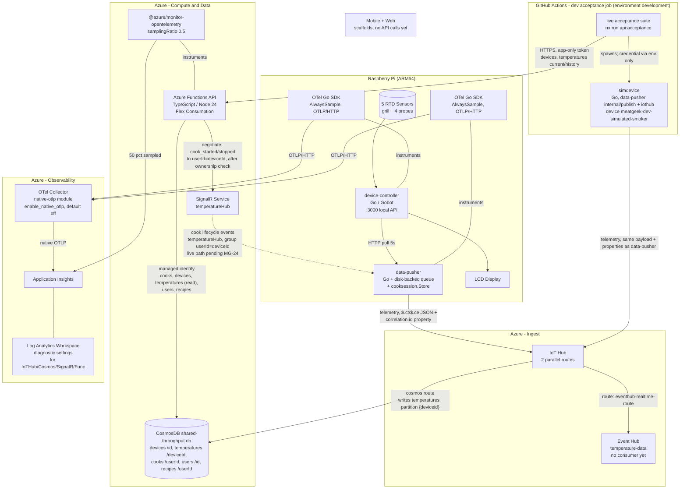
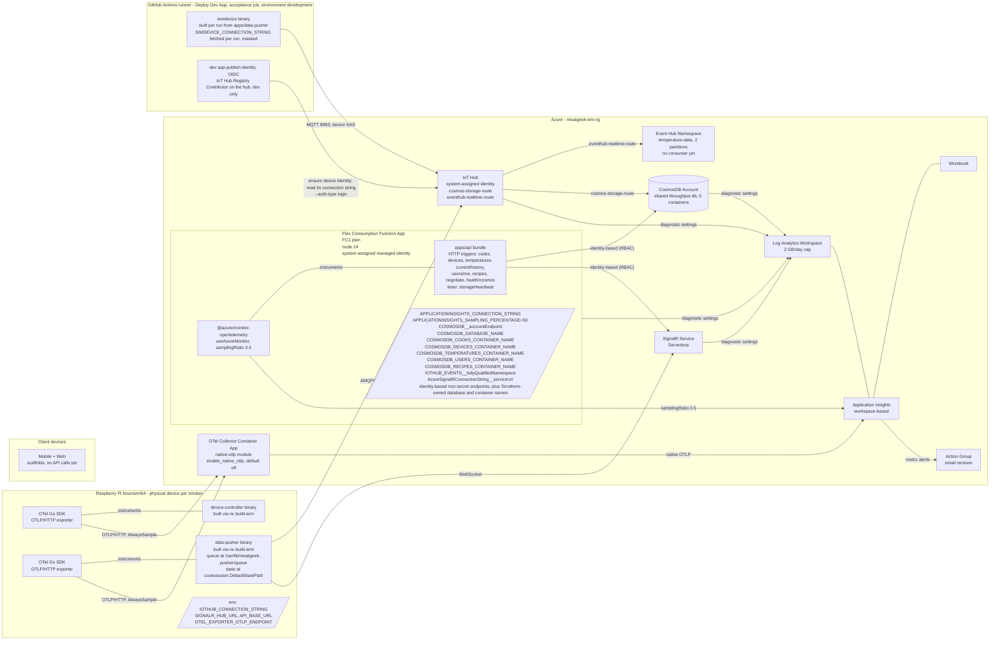
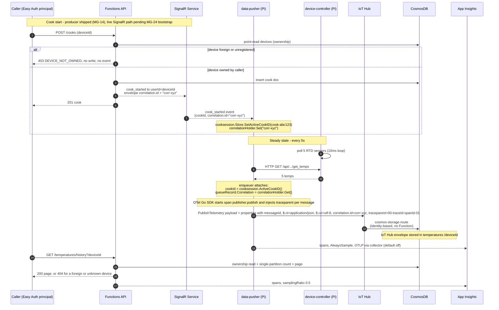
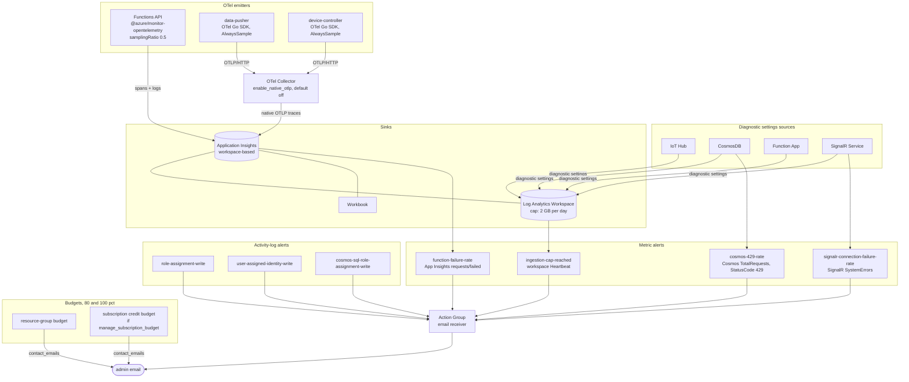
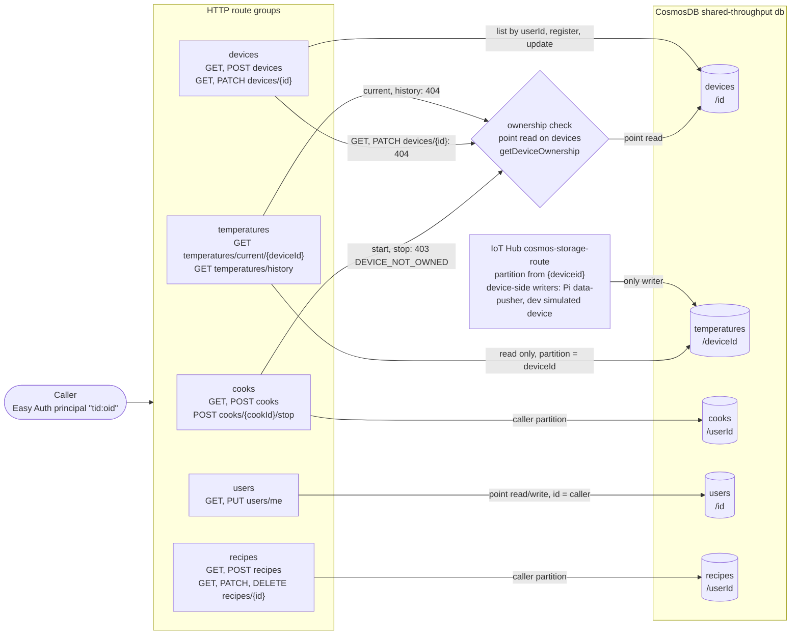
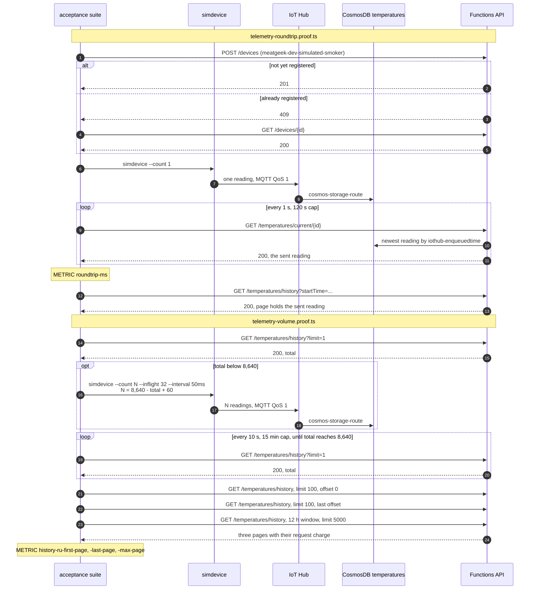

# MeatGeek V2 — Architecture Diagrams

These six diagrams show what is on `main` and nothing else: a component,
route or edge that the code and Terraform on `main` do not have is left out,
not drawn in a special style.

Each diagram has a prose legend immediately above it.

---

## 1. System Architecture (C4 Context + Container)

**Legend.** The Pi-side binaries (`device-controller`, `data-pusher`), the
Azure managed plane (IoT Hub, Event Hub, CosmosDB, SignalR, Functions) and
the observability sinks. IoT Hub writes every reading straight into the
`temperatures` container through its `cosmos-storage-route`; its
`eventhub-realtime-route` feeds an Event Hub that nothing consumes yet. The
API reads and writes the five Cosmos containers under its managed identity
and emits cook lifecycle events to SignalR. The mobile and web apps are
scaffolds that make no API or SignalR calls yet. The Go OTel SDKs export
OTLP to an OpenTelemetry Collector whose Terraform module is on `main` but
off by default (`enable_native_otlp = false`); with no
`OTEL_EXPORTER_OTLP_ENDPOINT` set they export nothing. A software device,
`simdevice` as `meatgeek-dev-simulated-smoker`, runs in the dev acceptance
job and sends the same messages as the Pi's data-pusher, and each run reads
them back through the API.

---

## 2. Deployment

**Legend.** What runs where. Pi binaries are cross-compiled to ARM64 and
copied to the device. The API deploys as a Flex Consumption Function App.
Every Azure resource is provisioned by Terraform in
`apps/infrastructure/modules/`. The Function App reaches Cosmos and SignalR
with its system-assigned managed identity and gets one app setting per
Cosmos container. The Event Hub namespace is provisioned and the Function
App holds its namespace setting, but no function in `apps/api` consumes it.
The OTel Collector Container App comes from the `native-otlp` module, which
is count-guarded off by default. In the `Deploy Dev App` acceptance job the
dev app-publish identity holds `IoT Hub Registry Contributor` on the dev hub
through `azurerm_role_assignment.simulated_device_registry_contributor`,
which exists only when `simulated_device_id` is set (only `dev.tfvars` sets
it, to `meatgeek-dev-simulated-smoker`); it ensures the device identity and
reads its connection string per run, so no device credential is stored
anywhere.

---

## 3. Cook Lifecycle Sequence — Two Correlation Axes

**Legend.** This sequence shows a cook starting, readings flowing while it
runs, and a caller reading the history back. The caller is any client
holding an Easy Auth principal; the mobile and web apps do not call the API
yet. Two independent correlation identifiers ride on each reading:

- **`correlation.id`** — *cook-scoped*. It originates in the SignalR
  `CorrelationContext.id` envelope when the API publishes `cook_started`.
  The data-pusher captures it in `correlationHolder`
  (`apps/data-pusher/cmd/main.go`) and stamps it on **every** outbound IoT
  Hub message via the `correlation.id` message property (constant
  `iothub.CorrelationIDPropertyName`). It is constant for the duration of a
  cook.
- **`traceparent`** — *per-message*, W3C Trace Context. The data-pusher's
  `publisher.publish` span context is injected into the `traceparent`
  property of each IoT Hub message. Every published message gets its own
  traceparent. No function on `main` reads it back: the Event Hub has no
  consumer, and the readings land in Cosmos without a Function in the path.

`startCook` and `stopCook` (registered in `apps/api/src/main.ts`) first do
one point read on `devices` to check that the caller owns the device. A
foreign or unregistered device gets `403 DEVICE_NOT_OWNED`, with no write
and no event. An owned device gets the cook written to `cooks` (partition =
the caller's `userId`), then a `cook_started` / `cook_stopped` event on the
`temperatureHub` SignalR hub to `userId = deviceId`. The data-pusher's
SignalR consumer latches the cook id and correlation id. The **live**
end-to-end SignalR path still awaits the MG-24 greenfield SignalR Service
bootstrap (AC5, see `docs/api/signalr-cook-events-smoke.md`); until an
operator runs it against live infrastructure, `cooksession.Reconcile`
against the REST API on startup remains the practical cook-id source.

---

## 4. Telemetry & Observability Flow

**Legend.** Drawn from `apps/infrastructure/modules/monitoring/main.tf` and
the three OTel setups. The API exports straight to Application Insights
through `@azure/monitor-opentelemetry` at a 0.5 sampling ratio. The two Go
services export OTLP/HTTP with `AlwaysSample` to the OTel Collector, which
forwards to Application Insights by native OTLP ingestion; the collector
module is off by default, and with no `OTEL_EXPORTER_OTLP_ENDPOINT` the Go
exporters are no-ops. IoT Hub, Cosmos, the Function App and SignalR send
diagnostic settings to Log Analytics. Four metric alerts and three
activity-log alerts notify one action group. The budgets email the admin
address directly through their own `contact_emails`, not the action group;
the subscription credit budget exists only when `manage_subscription_budget`
is set.

---

## 5. API data model and ownership

**Legend.** Each HTTP route group in `apps/api/src/main.ts`, the Cosmos
containers it touches, and the ownership point read on `devices` that the
cook, device and temperature routes do first.
Status codes on an edge are what a caller gets for a device it does not own;
IoT Hub is the only writer of `temperatures`; its device-side writers are the
Pi's data-pusher and, in dev, the simulated device.

---

## 6. Live telemetry proof (dev acceptance)

**Legend.** Every `Deploy Dev App` run's acceptance job proves the telemetry
path end to end with `apps/api/acceptance/proofs/telemetry-roundtrip.proof.ts`
and `telemetry-volume.proof.ts`, which run in that order. The suite calls the
deployed API with an app-only token and spawns `simdevice`
(`apps/data-pusher/cmd/simdevice`), which sends as the standing device
`meatgeek-dev-simulated-smoker` through the data-pusher's own
`internal/publish` and `internal/iothub` code: MQTT on 8883, device SAS,
QoS 1, with `messageId`, `traceparent` and `$.ct=application/json` /
`$.ce=utf-8` on every message. Its credential reaches it only through the
`SIMDEVICE_CONNECTION_STRING` environment variable. No Function is in the
write path: IoT Hub's `cosmos-storage-route` writes the reading into
`temperatures`, and the API reads it back. The round-trip proof times the
send until `GET /temperatures/current/{id}` returns the sent reading and
prints `METRIC roundtrip-ms`. The volume proof tops the device up to one long
cook's worth of readings (12 h at one every 5 s = 8,640) and prints the
request charge of three history pages. The job copies every `METRIC` line
into the run summary.

**Measured.** Single dev samples, not targets, read from the `Deploy Dev App`
run logs; each run's summary carries the current values.

| Metric | Value | Run |
|---|---|---|
| `roundtrip-ms` | 1211 | 44603121177 |
| `roundtrip-ms` | 1235 | 44612029684 |
| `history-total` | 8700 | 44612029684 |
| `history-ru-first-page` (limit 100, offset 0) | 11.95 RU | 44612029684 |
| `history-ru-last-page` (limit 100, offset 8600) | 24.12 RU | 44612029684 |
| `history-ru-max-page` (12 h window, limit 5000, 5000 readings) | 238.26 RU | 44612029684 |
| `topup-sent` / `topup-ms` | 2175 / 109996 (~19.8 readings/s) | 44612029684 |

A history page's `OFFSET` cost grows with the skip: the same 100-reading page
costs 11.95 RU at offset 0 and 24.12 RU at offset 8,600, because Cosmos still
reads the skipped readings. Every history request also pays a `COUNT(1)` over
the device's partition for its `total`.

---

## Notes on what this document does NOT show

- **Authentication / authorization**: the Function App runs under a
  **system-assigned managed identity**. Runtime access to Cosmos, host
  Storage, the IoT-telemetry Event Hub, and SignalR is **identity-based
  (RBAC + non-secret endpoints)** — the `app_settings` in
  `apps/infrastructure/modules/functions/main.tf` carry only non-secret
  endpoint URIs (`COSMOSDB__accountEndpoint`,
  `IOTHUB_EVENTS__fullyQualifiedNamespace`,
  `AzureSignalRConnectionString__serviceUri`) resolved against that
  identity, **never** connection strings or primary keys, and no such
  secret is emitted as a Terraform output. Alongside the Cosmos endpoint sit
  six plain (non-endpoint) values the API reads itself rather than the host
  resolving them: `COSMOSDB_DATABASE_NAME` and one container name per
  container, `COSMOSDB_COOKS_CONTAINER_NAME`,
  `COSMOSDB_DEVICES_CONTAINER_NAME`, `COSMOSDB_TEMPERATURES_CONTAINER_NAME`,
  `COSMOSDB_USERS_CONTAINER_NAME` and `COSMOSDB_RECIPES_CONTAINER_NAME`. All
  are Terraform-owned: the database name is
  `module.cosmos_db.destination_database_name`, the MG-53 shared-throughput
  destination the MG-62 cutover repointed both dev consumers onto, required
  with no default, so the app can never be deployed pointed at a database
  that does not exist (MG-51). The Flex deployment storage uses the same
  identity (`storage_authentication_type = "SystemAssignedIdentity"` on a
  `blobContainer`; shared-key access disabled).
  The single non-secret exception is Application Insights, wired via its
  telemetry `APPLICATIONINSIGHTS_CONNECTION_STRING`. App Service
  Authentication (Easy Auth) is configured **default-deny**. The caller
  identity every route uses is the Easy Auth principal, `"<tid>:<oid>"`.
  The diagrams above show logical data flows, not the full RBAC posture.
- **Cook session state recovery** detail: the SignalR producer side
  (API emitting `cook_started` / `cook_stopped`) **shipped in MG-14**, so
  the data-pusher's SignalR consumer now has a real producer. Until the
  MG-24 SignalR Service bootstrap makes the live path runnable (AC5, see
  `docs/api/signalr-cook-events-smoke.md`), `cooksession.Reconcile` against
  the REST API at startup remains the practical cook-id source. Diagram 3
  calls this out in the cook-start step.
- **The simulated device's credential**: the dev acceptance job fetches
  `meatgeek-dev-simulated-smoker`'s connection string per run under OIDC as
  the dev app-publish identity, masks it (the string and its key), and holds
  it only in the acceptance suite step's environment. It is never stored —
  no repo secret, no Key Vault, no hub shared-access policy — and never
  passed to PR CI (`ci.yml`).
