<!--
  GENERATED FILE. Do not edit by hand: your change will fail `npm run check` and be
  overwritten. Generated from the LikeC4 model in docs/architecture/likec4/ by
  docs/architecture/likec4/scripts/gen-diagrams.mjs. To change a diagram, change the model,
  then regenerate from the repository root: npm --prefix docs/architecture/likec4 run gen:diagrams
-->

# MeatGeek V2 — Architecture Diagrams

> **Generated from the [LikeC4 model](likec4/). Do not edit this file by hand.**
> Change the model, then run `npm --prefix docs/architecture/likec4 run gen:diagrams`.
> `npm run check`, and so CI, fails when this file is stale.

The interactive site, https://stevebargelt.github.io/meatgeekv2/, is the primary way to read the architecture:
it draws every view with its styles, shows each element and step with its description,
and links each view to the views below it. This file renders the same views as Mermaid
so that they also show inline on GitHub. Mermaid keeps the fill colours but not the faded
opacity or the dashed and dotted borders the site gives to elements that are not live,
so check the site when an element's state matters. A flow (a dynamic view) is drawn as a
flowchart without step numbers; its numbered steps and their notes follow the diagram.

17 views, grouped as: Landscape and containers (3), Drill-downs (6), Deployment (1), Flows, today (7).

**Legend: the honesty convention**, copied from the
[model README](likec4/README.md#the-honesty-convention).

The model shows what the code on `main` actually does, and marks everything else.
Every element and relationship that is not plainly live says so.

Element tags (defined in `spec.c4`, styled in `views.c4`):

| Tag         | Use it when                                                                            |
| ----------- | -------------------------------------------------------------------------------------- |
| `#live`     | It is on `main` and runs in the deployed environment today.                            |
| `#scaffold` | Code exists on `main` but is a stub or is not wired up, so it does not do the job yet. |
| `#notBuilt` | Nothing on `main`, and no decision to build it yet. Drawn faded.                       |
| `#decided`  | The owner has decided to build it, but it is not on `main` yet.                        |
| `#retiring` | It is on `main` today and has been decided for removal.                                |

Relationship kinds (`a -[kind]-> b`; a plain `->` means "live today"):

| Kind       | Use it when                                                                |
| ---------- | -------------------------------------------------------------------------- |
| `planned`  | The connection is not built, and there is no decision to build it yet.     |
| `decided`  | The connection is decided and will be built, but is not on `main` yet.     |
| `retiring` | The connection exists in the code today and is going to be removed.        |
| `event`    | An asynchronous message (queue, event stream, IoT Hub route) that is live. |

**The rule:** a view that shows current state never draws a decided or not-built
path as if it were live. Decided designs go in their own views, whose id ends in
`Target` (for example `probeAlertTarget` in "Add a flow" below). A current-state view
may still include a `#decided` or `#notBuilt` element, because the view styles
render those dashed or faded, but its flows describe only what runs today.

---

# Landscape and containers

## MeatGeek V2: landscape

Who uses it, what it depends on, and how changes reach it. MeatGeek V2 is three things: the device on the smoker, the cloud, and the apps. The web app is live on Vercel; sky dashed is the iOS app, decided and not built. Click a box to go down a level.

View `index` on the site: https://stevebargelt.github.io/meatgeekv2/#/view/index/

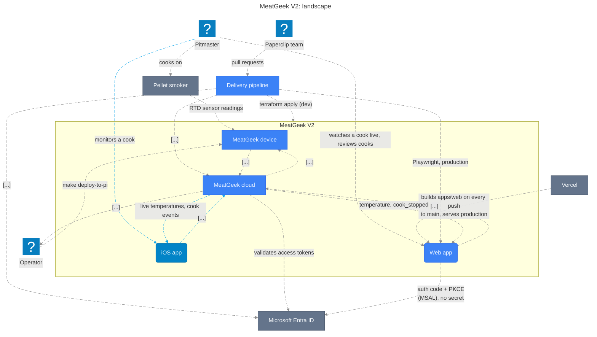

## MeatGeek V2: containers

Everything that runs. Sky dashed is decided and not built: the iOS app. Grey dotted is not built, with no decision.

View `system` on the site: https://stevebargelt.github.io/meatgeekv2/#/view/system/

```mermaid
---
title: "MeatGeek V2: containers"
---
graph TB
  Pitmaster@{ icon: "fa:user", shape: rounded, label: "Pitmaster" }
  Vercel@{ shape: rectangle, label: "Vercel" }
  subgraph Meatgeek["`MeatGeek V2`"]
    subgraph Meatgeek.Cloud["`MeatGeek cloud`"]
      subgraph Meatgeek.Cloud.Ingest["`Ingest`"]
        Meatgeek.Cloud.Ingest.Eventhub@{ shape: horizontal-cylinder, label: "Event Hub: temperature-data" }
        Meatgeek.Cloud.Ingest.Iothub@{ shape: rectangle, label: "IoT Hub" }
      end
      subgraph Meatgeek.Cloud.Observability["`Observability`"]
        Meatgeek.Cloud.Observability.Budgets@{ shape: rectangle, label: "Budgets" }
        Meatgeek.Cloud.Observability.ActivityAlerts@{ shape: rectangle, label: "Activity-log alerts" }
        Meatgeek.Cloud.Observability.ActionGroup@{ shape: rectangle, label: "Action group" }
        Meatgeek.Cloud.Observability.Collector@{ shape: rectangle, label: "OTLP collector" }
        Meatgeek.Cloud.Observability.Workbook@{ shape: rectangle, label: "Workbook" }
        Meatgeek.Cloud.Observability.Appinsights@{ shape: rectangle, label: "Application Insights" }
        Meatgeek.Cloud.Observability.Logs@{ shape: rectangle, label: "Log Analytics" }
        Meatgeek.Cloud.Observability.MetricAlerts@{ shape: rectangle, label: "Metric alerts" }
      end
      Meatgeek.Cloud.Api@{ shape: rectangle, label: "Functions API" }
      Meatgeek.Cloud.Deviceupdate@{ shape: rectangle, label: "Device Update for IoT Hub" }
      Meatgeek.Cloud.Realtime@{ shape: rectangle, label: "SignalR Service" }
      Meatgeek.Cloud.Data@{ shape: disk, label: "Cosmos DB" }
    end
    subgraph Meatgeek.Edge["`MeatGeek device`"]
      Meatgeek.Edge.Updater@{ shape: rectangle, label: "update agent" }
      Meatgeek.Edge.Pusher@{ shape: rectangle, label: "data-pusher" }
      Meatgeek.Edge.Controller@{ shape: rectangle, label: "device-controller" }
    end
    Meatgeek.Mobile@{ shape: rounded, label: "iOS app" }
    Meatgeek.Web@{ shape: rounded, label: "Web app" }
  end
  subgraph Delivery["`Delivery pipeline`"]
    Delivery.Simdevice@{ shape: rectangle, label: "simdevice" }
  end
  Smoker@{ shape: rectangle, label: "Pellet smoker" }
  Operator@{ icon: "fa:user", shape: rounded, label: "Operator" }
  Entra@{ shape: rectangle, label: "Microsoft Entra ID" }
  Pitmaster -. "`monitors a cook`" .-> Meatgeek.Mobile
  Pitmaster -. "`watches a cook live, reviews cooks`" .-> Meatgeek.Web
  Vercel -. "`builds apps/web on every push
to main, serves production`" .-> Meatgeek.Web
  Meatgeek.Web -. "`auth code + PKCE
(MSAL), no secret`" .-> Entra
  Operator -. "`make deploy-to-pi`" .-> Meatgeek.Edge.Controller
  Operator -. "`make deploy-to-pi`" .-> Meatgeek.Edge.Pusher
  Smoker -. "`RTD sensor readings`" .-> Meatgeek.Edge.Controller
  Meatgeek.Edge.Pusher -. "`GET get_status, every 5 s`" .-> Meatgeek.Edge.Controller
  Meatgeek.Edge.Updater -. "`installs, restarts`" .-> Meatgeek.Edge.Controller
  Meatgeek.Edge.Updater -. "`installs, restarts`" .-> Meatgeek.Edge.Pusher
  Meatgeek.Mobile -. "`REST`" .-> Meatgeek.Cloud.Api
  Meatgeek.Web -. "`REST, user access
token (access_as_user)`" .-> Meatgeek.Cloud.Api
  Meatgeek.Web -. "`connects as the signed-in user`" .-> Meatgeek.Cloud.Realtime
  Meatgeek.Cloud.Api -. "`validates access tokens`" .-> Entra
  Meatgeek.Cloud.Realtime -. "`live temperatures, cook events`" .-> Meatgeek.Mobile
  Meatgeek.Cloud.Realtime -. "`temperature, cook_stopped`" .-> Meatgeek.Web
  Meatgeek.Cloud.Api -. "`[...]`" .-> Meatgeek.Cloud.Data
  Meatgeek.Cloud.Api -. "`[...]`" .-> Meatgeek.Cloud.Realtime
  Meatgeek.Cloud.Data -. "`change feed (leases)`" .-> Meatgeek.Cloud.Api
  Meatgeek.Edge.Pusher -. "`[...]`" .-> Meatgeek.Cloud.Ingest.Iothub
  Meatgeek.Edge.Updater -. "`installed version, result`" .-> Meatgeek.Cloud.Ingest.Iothub
  Meatgeek.Cloud.Deviceupdate -. "`deployment to a device group`" .-> Meatgeek.Cloud.Ingest.Iothub
  Meatgeek.Cloud.Api -. "`[...]`" .-> Meatgeek.Cloud.Ingest.Iothub
  Meatgeek.Cloud.Ingest.Iothub -. "`desired properties`" .-> Meatgeek.Edge.Pusher
  Meatgeek.Cloud.Ingest.Iothub -. "`update available`" .-> Meatgeek.Edge.Updater
  Meatgeek.Cloud.Ingest.Iothub -. "`cosmos-storage-route`" .-> Meatgeek.Cloud.Data
  Meatgeek.Cloud.Ingest.Eventhub -. "`Event Hub trigger`" .-> Meatgeek.Cloud.Api
  Meatgeek.Cloud.Ingest.Iothub -. "`eventhub-realtime-route`" .-> Meatgeek.Cloud.Ingest.Eventhub
  Meatgeek.Edge.Controller -. "`OTLP/HTTP`" .-> Meatgeek.Cloud.Observability.Collector
  Meatgeek.Edge.Pusher -. "`OTLP/HTTP`" .-> Meatgeek.Cloud.Observability.Collector
  Meatgeek.Cloud.Api -. "`traces and logs, samplingRatio 0.5`" .-> Meatgeek.Cloud.Observability.Appinsights
  Meatgeek.Cloud.Api -. "`diagnostic settings`" .-> Meatgeek.Cloud.Observability.Logs
  Meatgeek.Cloud.Data -. "`diagnostic settings`" .-> Meatgeek.Cloud.Observability.Logs
  Meatgeek.Cloud.Data -. "`cosmos-429-rate`" .-> Meatgeek.Cloud.Observability.MetricAlerts
  Meatgeek.Cloud.Realtime -. "`diagnostic settings`" .-> Meatgeek.Cloud.Observability.Logs
  Meatgeek.Cloud.Realtime -. "`signalr-connection-failure-rate`" .-> Meatgeek.Cloud.Observability.MetricAlerts
  Meatgeek.Cloud.Ingest.Iothub -. "`diagnostic settings`" .-> Meatgeek.Cloud.Observability.Logs
  Meatgeek.Cloud.Observability.ActionGroup -. "`alert email`" .-> Operator
  Meatgeek.Cloud.Observability.Budgets -. "`budget email (contact_emails)`" .-> Operator
  Meatgeek.Cloud.Observability.Appinsights -. "`stores in`" .-> Meatgeek.Cloud.Observability.Logs
  Meatgeek.Cloud.Observability.Appinsights -. "`function-failure-rate`" .-> Meatgeek.Cloud.Observability.MetricAlerts
  Meatgeek.Cloud.Observability.Workbook -. "`queries`" .-> Meatgeek.Cloud.Observability.Appinsights
  Meatgeek.Cloud.Observability.Collector -. "`native OTLP`" .-> Meatgeek.Cloud.Observability.Appinsights
  Meatgeek.Cloud.Observability.Logs -. "`ingestion-cap-reached`" .-> Meatgeek.Cloud.Observability.MetricAlerts
  Meatgeek.Cloud.Observability.MetricAlerts -. "`four metric alerts`" .-> Meatgeek.Cloud.Observability.ActionGroup
  Meatgeek.Cloud.Observability.ActivityAlerts -. "`three activity-log alerts`" .-> Meatgeek.Cloud.Observability.ActionGroup
  Pitmaster -. "`cooks on`" .-> Smoker
  Delivery.Simdevice -. "`telemetry as <sim>, <sim>-
chart or <sim>-web: messageId,
$.ct=application/json, $.ce=utf-
8, traceparent`" .-> Meatgeek.Cloud.Ingest.Iothub
  classDef muted fill:#64748b,stroke:#475569,color:#f8fafc
  class Vercel,Smoker,Meatgeek.Edge.Updater,Meatgeek.Cloud.Deviceupdate,Entra muted
  classDef indigo fill:#6366f1,stroke:#4f46e5,color:#eef2ff
  class Meatgeek.Cloud.Ingest.Eventhub,Meatgeek.Cloud.Observability.Budgets,Meatgeek.Cloud.Observability.ActivityAlerts,Meatgeek.Cloud.Observability.ActionGroup,Meatgeek.Cloud.Realtime,Meatgeek.Cloud.Ingest.Iothub,Meatgeek.Cloud.Observability.Workbook,Meatgeek.Cloud.Observability.Appinsights,Meatgeek.Cloud.Observability.Logs,Meatgeek.Cloud.Observability.MetricAlerts indigo
  classDef primary fill:#3b82f6,stroke:#2563eb,color:#eff6ff
  class Delivery.Simdevice,Meatgeek.Web,Meatgeek.Edge.Pusher,Meatgeek.Edge.Controller,Meatgeek.Cloud.Api primary
  classDef sky fill:#0284c7,stroke:#0369a1,color:#f0f9ff
  class Meatgeek.Mobile sky
  classDef green fill:#428a4f,stroke:#2d5d39,color:#f8fafc
  class Meatgeek.Cloud.Data green
  classDef amber fill:#A35829,stroke:#7E451D,color:#FFE0C2
  class Meatgeek.Cloud.Observability.Collector amber
  linkStyle 0,10,14 stroke:#0ea5e9,stroke-dasharray:8 4
  linkStyle 1,2,3,4,5,6,7,11,12,13,15,16,22,23,30,31,32,33,34,35,36,37,38,39,40,41,43,44,45,46 stroke:#8D8D8D,stroke-dasharray:8 4
  linkStyle 8,9,20,21,24,28,29,42 stroke:#8D8D8D
  linkStyle 17,18,19,25,26,27,47 stroke:#b45309,stroke-dasharray:8 4
```

## MeatGeek cloud (Azure)

View `cloud` on the site: https://stevebargelt.github.io/meatgeekv2/#/view/cloud/

```mermaid
---
title: "MeatGeek cloud (Azure)"
---
graph TB
  subgraph MeatgeekCloud["`MeatGeek cloud`"]
    subgraph MeatgeekCloud.Api["`Functions API`"]
      MeatgeekCloud.Api.Rollup@{ shape: rectangle, label: "rollupTemperatures" }
      MeatgeekCloud.Api.Cooks@{ shape: rectangle, label: "cooks" }
      MeatgeekCloud.Api.Broadcast@{ shape: rectangle, label: "realtime broadcast" }
      MeatgeekCloud.Api.Negotiate@{ shape: rectangle, label: "negotiate" }
    end
    subgraph MeatgeekCloud.Data["`Cosmos DB`"]
      MeatgeekCloud.Data.TemperatureRollups@{ shape: cylinder, label: "temperature-rollups" }
    end
    MeatgeekCloud.Deviceupdate@{ shape: rectangle, label: "Device Update for IoT Hub" }
    subgraph MeatgeekCloud.Ingest["`Ingest`"]
      MeatgeekCloud.Ingest.Iothub@{ shape: rectangle, label: "IoT Hub" }
      MeatgeekCloud.Ingest.Eventhub@{ shape: horizontal-cylinder, label: "Event Hub: temperature-data" }
    end
    MeatgeekCloud.Realtime@{ shape: rectangle, label: "SignalR Service" }
    subgraph MeatgeekCloud.Observability["`Observability`"]
      MeatgeekCloud.Observability.Budgets@{ shape: rectangle, label: "Budgets" }
      MeatgeekCloud.Observability.Workbook@{ shape: rectangle, label: "Workbook" }
      MeatgeekCloud.Observability.Collector@{ shape: rectangle, label: "OTLP collector" }
      MeatgeekCloud.Observability.ActivityAlerts@{ shape: rectangle, label: "Activity-log alerts" }
      MeatgeekCloud.Observability.Appinsights@{ shape: rectangle, label: "Application Insights" }
      MeatgeekCloud.Observability.Logs@{ shape: rectangle, label: "Log Analytics" }
      MeatgeekCloud.Observability.MetricAlerts@{ shape: rectangle, label: "Metric alerts" }
      MeatgeekCloud.Observability.ActionGroup@{ shape: rectangle, label: "Action group" }
    end
  end
  Entra@{ shape: rectangle, label: "Microsoft Entra ID" }
  subgraph Delivery["`Delivery pipeline`"]
    Delivery.Simdevice@{ shape: rectangle, label: "simdevice" }
  end
  subgraph MeatgeekEdge["`MeatGeek device`"]
    MeatgeekEdge.PusherTwin@{ shape: rectangle, label: "twin client" }
  end
  MeatgeekMobile@{ shape: rounded, label: "iOS app" }
  subgraph MeatgeekWeb["`Web app`"]
    MeatgeekWeb.LivePanel@{ shape: rectangle, label: "live panel" }
    MeatgeekWeb.Chart@{ shape: rectangle, label: "chart" }
  end
  Operator@{ icon: "fa:user", shape: rounded, label: "Operator" }
  MeatgeekCloud.Realtime -. "`live temperatures, cook events`" .-> MeatgeekMobile
  MeatgeekCloud.Deviceupdate -. "`deployment to a device group`" .-> MeatgeekCloud.Ingest.Iothub
  MeatgeekCloud.Ingest.Iothub -. "`eventhub-realtime-route`" .-> MeatgeekCloud.Ingest.Eventhub
  MeatgeekCloud.Realtime -. "`diagnostic settings`" .-> MeatgeekCloud.Observability.Logs
  MeatgeekCloud.Realtime -. "`signalr-connection-failure-rate`" .-> MeatgeekCloud.Observability.MetricAlerts
  MeatgeekCloud.Ingest.Iothub -. "`diagnostic settings`" .-> MeatgeekCloud.Observability.Logs
  MeatgeekCloud.Observability.ActionGroup -. "`alert email`" .-> Operator
  MeatgeekCloud.Observability.Budgets -. "`budget email (contact_emails)`" .-> Operator
  MeatgeekCloud.Observability.Appinsights -. "`stores in`" .-> MeatgeekCloud.Observability.Logs
  MeatgeekCloud.Observability.Appinsights -. "`function-failure-rate`" .-> MeatgeekCloud.Observability.MetricAlerts
  MeatgeekCloud.Observability.Workbook -. "`queries`" .-> MeatgeekCloud.Observability.Appinsights
  MeatgeekCloud.Observability.Collector -. "`native OTLP`" .-> MeatgeekCloud.Observability.Appinsights
  MeatgeekCloud.Observability.Logs -. "`ingestion-cap-reached`" .-> MeatgeekCloud.Observability.MetricAlerts
  MeatgeekCloud.Observability.MetricAlerts -. "`four metric alerts`" .-> MeatgeekCloud.Observability.ActionGroup
  MeatgeekCloud.Observability.ActivityAlerts -. "`three activity-log alerts`" .-> MeatgeekCloud.Observability.ActionGroup
  MeatgeekCloud.Api.Cooks -. "`cook_started, cook_stopped
to the owning userId`" .-> MeatgeekCloud.Realtime
  MeatgeekCloud.Api.Cooks -. "`set twin desired properties`" .-> MeatgeekCloud.Ingest.Iothub
  MeatgeekMobile -. "`negotiate`" .-> MeatgeekCloud.Api.Negotiate
  MeatgeekCloud.Api.Negotiate -. "`mint client token for the caller`" .-> MeatgeekCloud.Realtime
  MeatgeekCloud.Ingest.Eventhub -. "`Event Hub trigger`" .-> MeatgeekCloud.Api.Broadcast
  MeatgeekCloud.Api.Broadcast -. "`each reading, to its device owner`" .-> MeatgeekCloud.Realtime
  MeatgeekCloud.Api.Rollup -. "`read-merge-replace, If-Match`" .-> MeatgeekCloud.Data.TemperatureRollups
  MeatgeekCloud.Ingest.Iothub -. "`desired properties`" .-> MeatgeekEdge.PusherTwin
  MeatgeekEdge.PusherTwin -. "`reported properties`" .-> MeatgeekCloud.Ingest.Iothub
  MeatgeekCloud.Realtime -. "`temperature, cook_stopped`" .-> MeatgeekWeb.LivePanel
  MeatgeekWeb.LivePanel -. "`connects as the signed-in user`" .-> MeatgeekCloud.Realtime
  MeatgeekWeb.LivePanel -. "`POST /negotiate`" .-> MeatgeekCloud.Api.Negotiate
  MeatgeekWeb.LivePanel -. "`pushed readings`" .-> MeatgeekWeb.Chart
  MeatgeekWeb.Chart -. "`GET /cooks/{cookId}/chart`" .-> MeatgeekCloud.Api.Cooks
  Delivery.Simdevice -. "`telemetry as <sim>, <sim>-
chart or <sim>-web: messageId,
$.ct=application/json, $.ce=utf-
8, traceparent`" .-> MeatgeekCloud.Ingest.Iothub
  MeatgeekCloud.Api -. "`diagnostic settings`" .-> MeatgeekCloud.Observability.Logs
  MeatgeekCloud.Data -. "`diagnostic settings`" .-> MeatgeekCloud.Observability.Logs
  MeatgeekCloud.Data -. "`cosmos-429-rate`" .-> MeatgeekCloud.Observability.MetricAlerts
  classDef muted fill:#64748b,stroke:#475569,color:#f8fafc
  class Entra,MeatgeekCloud.Deviceupdate muted
  classDef primary fill:#3b82f6,stroke:#2563eb,color:#eff6ff
  class MeatgeekCloud.Api.Rollup,Delivery.Simdevice,MeatgeekCloud.Api.Cooks,MeatgeekCloud.Api.Broadcast,MeatgeekEdge.PusherTwin,MeatgeekWeb.LivePanel,MeatgeekCloud.Api.Negotiate,MeatgeekWeb.Chart primary
  classDef green fill:#428a4f,stroke:#2d5d39,color:#f8fafc
  class MeatgeekCloud.Data.TemperatureRollups green
  classDef indigo fill:#6366f1,stroke:#4f46e5,color:#eef2ff
  class MeatgeekCloud.Ingest.Iothub,MeatgeekCloud.Ingest.Eventhub,MeatgeekCloud.Realtime,MeatgeekCloud.Observability.Budgets,MeatgeekCloud.Observability.Workbook,MeatgeekCloud.Observability.ActivityAlerts,MeatgeekCloud.Observability.Appinsights,MeatgeekCloud.Observability.Logs,MeatgeekCloud.Observability.MetricAlerts,MeatgeekCloud.Observability.ActionGroup indigo
  classDef sky fill:#0284c7,stroke:#0369a1,color:#f0f9ff
  class MeatgeekMobile sky
  classDef amber fill:#A35829,stroke:#7E451D,color:#FFE0C2
  class MeatgeekCloud.Observability.Collector amber
  linkStyle 0,17 stroke:#0ea5e9,stroke-dasharray:8 4
  linkStyle 1,11 stroke:#8D8D8D
  linkStyle 2,15,19,29 stroke:#b45309,stroke-dasharray:8 4
  linkStyle 3,4,5,6,7,8,9,10,12,13,14,16,18,20,21,22,23,24,25,26,27,28,30,31,32 stroke:#8D8D8D,stroke-dasharray:8 4
```

---

# Drill-downs

## MeatGeek device (Raspberry Pi)

View `edge` on the site: https://stevebargelt.github.io/meatgeekv2/#/view/edge/

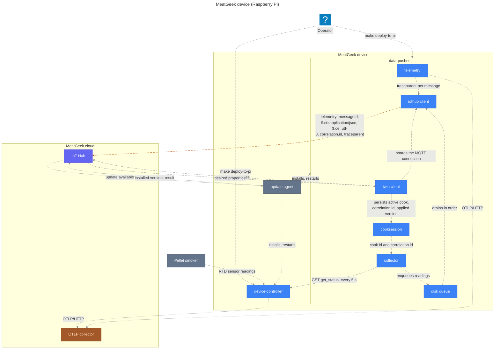

## Functions API

Every route is anonymous at the Functions runtime on purpose: Easy Auth (default-deny,
Return401) has already validated the token. The cook, device and temperature routes first
call `getDeviceOwnership`, one point read on `devices`. For a device the caller does not
own: cooks start/stop answer `403 DEVICE_NOT_OWNED` (no write, no event), `GET`/`PATCH
/devices/{id}` answer 404, `DELETE /devices/{id}` answers `403 DEVICE_NOT_OWNED` (nothing
deleted) and `404 DEVICE_NOT_FOUND` for an unknown device, and temperatures current/history
answer `404 DEVICE_NOT_FOUND`.

View `api` on the site: https://stevebargelt.github.io/meatgeekv2/#/view/api/

```mermaid
---
title: "Functions API"
---
graph TB
  Delivery@{ shape: rectangle, label: "Delivery pipeline" }
  MeatgeekMobile@{ shape: rounded, label: "iOS app" }
  MeatgeekWeb@{ shape: rounded, label: "Web app" }
  subgraph MeatgeekCloudApi["`Functions API`"]
    MeatgeekCloudApi.Negotiate@{ shape: rectangle, label: "negotiate" }
    MeatgeekCloudApi.Easyauth@{ shape: rectangle, label: "Easy Auth" }
    MeatgeekCloudApi.Health@{ shape: rectangle, label: "health" }
    MeatgeekCloudApi.Rollup@{ shape: rectangle, label: "rollupTemperatures" }
    MeatgeekCloudApi.Otel@{ shape: rectangle, label: "telemetry" }
    MeatgeekCloudApi.Principal@{ shape: rectangle, label: "principal" }
    MeatgeekCloudApi.Cooks@{ shape: rectangle, label: "cooks" }
    MeatgeekCloudApi.Devices@{ shape: rectangle, label: "devices" }
    MeatgeekCloudApi.Temperatures@{ shape: rectangle, label: "temperatures" }
    MeatgeekCloudApi.Recipes@{ shape: rectangle, label: "recipes" }
    MeatgeekCloudApi.Users@{ shape: rectangle, label: "users" }
    MeatgeekCloudApi.Ownership@{ shape: rectangle, label: "ownership check" }
    MeatgeekCloudApi.Broadcast@{ shape: rectangle, label: "realtime broadcast" }
    MeatgeekCloudApi.Repos@{ shape: rectangle, label: "cosmos repositories" }
  end
  Entra@{ shape: rectangle, label: "Microsoft Entra ID" }
  subgraph MeatgeekCloudObservability["`Observability`"]
    MeatgeekCloudObservability.Appinsights@{ shape: rectangle, label: "Application Insights" }
  end
  subgraph MeatgeekCloudIngest["`Ingest`"]
    MeatgeekCloudIngest.Iothub@{ shape: rectangle, label: "IoT Hub" }
    MeatgeekCloudIngest.Eventhub@{ shape: horizontal-cylinder, label: "Event Hub: temperature-data" }
  end
  MeatgeekEdgePusherTwin@{ shape: rectangle, label: "twin client" }
  MeatgeekCloudRealtime@{ shape: rectangle, label: "SignalR Service" }
  subgraph MeatgeekCloudData["`Cosmos DB`"]
    MeatgeekCloudData.TemperatureRollups@{ shape: cylinder, label: "temperature-rollups" }
    MeatgeekCloudData.Leases@{ shape: cylinder, label: "leases" }
    MeatgeekCloudData.Devices@{ shape: cylinder, label: "devices" }
    MeatgeekCloudData.Temperatures@{ shape: cylinder, label: "temperatures" }
    MeatgeekCloudData.Cooks@{ shape: cylinder, label: "cooks" }
    MeatgeekCloudData.Users@{ shape: cylinder, label: "users" }
    MeatgeekCloudData.Recipes@{ shape: cylinder, label: "recipes" }
  end
  Delivery -. "`GET /cooks/{cookId}/chart`" .-> MeatgeekCloudApi.Cooks
  Delivery -. "`POST /devices/claim with the
claim code the device minted:
201, or 200 on a retry`" .-> MeatgeekCloudApi.Devices
  Delivery -. "`[...]`" .-> MeatgeekCloudApi.Temperatures
  Delivery -. "`POST /negotiate (signalr proofs)`" .-> MeatgeekCloudApi.Negotiate
  MeatgeekMobile -. "`negotiate`" .-> MeatgeekCloudApi.Negotiate
  MeatgeekWeb -. "`[...]`" .-> MeatgeekCloudApi.Cooks
  MeatgeekWeb -. "`GET, POST /devices;
PATCH /devices/{id}`" .-> MeatgeekCloudApi.Devices
  MeatgeekWeb -. "`GET
/temperatures/current/{deviceId}
(backfill)`" .-> MeatgeekCloudApi.Temperatures
  MeatgeekWeb -. "`POST /negotiate`" .-> MeatgeekCloudApi.Negotiate
  MeatgeekCloudApi.Easyauth -. "`X-MS-CLIENT-PRINCIPAL`" .-> MeatgeekCloudApi.Principal
  MeatgeekCloudApi.Principal -. "`userId`" .-> MeatgeekCloudApi.Cooks
  MeatgeekCloudApi.Principal -. "`userId`" .-> MeatgeekCloudApi.Devices
  MeatgeekCloudApi.Principal -. "`userId`" .-> MeatgeekCloudApi.Temperatures
  MeatgeekCloudApi.Principal -. "`userId`" .-> MeatgeekCloudApi.Recipes
  MeatgeekCloudApi.Principal -. "`userId`" .-> MeatgeekCloudApi.Users
  MeatgeekCloudApi.Cooks -. "`start, stop: 403
DEVICE_NOT_OWNED`" .-> MeatgeekCloudApi.Ownership
  MeatgeekCloudApi.Cooks -. "`[...]`" .-> MeatgeekCloudApi.Repos
  MeatgeekCloudApi.Devices -. "`[...]`" .-> MeatgeekCloudApi.Ownership
  MeatgeekCloudApi.Devices -. "`list by userId, register,
update, delete`" .-> MeatgeekCloudApi.Repos
  MeatgeekCloudApi.Temperatures -. "`current, history: 404
DEVICE_NOT_FOUND`" .-> MeatgeekCloudApi.Ownership
  MeatgeekCloudApi.Temperatures -. "`query readings`" .-> MeatgeekCloudApi.Repos
  MeatgeekCloudApi.Recipes -.-> MeatgeekCloudApi.Repos
  MeatgeekCloudApi.Users -.-> MeatgeekCloudApi.Repos
  MeatgeekCloudApi.Health -. "`probe`" .-> MeatgeekCloudApi.Repos
  MeatgeekCloudApi.Broadcast -. "`owner of each device in the batch`" .-> MeatgeekCloudApi.Repos
  MeatgeekCloudApi.Easyauth -. "`validates access tokens`" .-> Entra
  MeatgeekCloudApi.Cooks -. "`cook_started, cook_stopped
to the owning userId`" .-> MeatgeekCloudRealtime
  MeatgeekCloudApi.Negotiate -. "`mint client token for the caller`" .-> MeatgeekCloudRealtime
  MeatgeekCloudApi.Broadcast -. "`each reading, to its device owner`" .-> MeatgeekCloudRealtime
  MeatgeekCloudApi.Rollup -. "`read-merge-replace, If-Match`" .-> MeatgeekCloudData.TemperatureRollups
  MeatgeekCloudApi.Rollup -. "`change-feed checkpoints`" .-> MeatgeekCloudData.Leases
  MeatgeekCloudApi.Ownership -. "`point read`" .-> MeatgeekCloudData.Devices
  MeatgeekCloudApi.Repos -. "`list by userId, register,
update, delete`" .-> MeatgeekCloudData.Devices
  MeatgeekCloudApi.Repos -. "`read only; partition = deviceId`" .-> MeatgeekCloudData.Temperatures
  MeatgeekCloudApi.Repos -. "`read, write; caller partition`" .-> MeatgeekCloudData.Cooks
  MeatgeekCloudApi.Repos -. "`point read, write; id = caller`" .-> MeatgeekCloudData.Users
  MeatgeekCloudApi.Repos -. "`read, write; caller partition`" .-> MeatgeekCloudData.Recipes
  MeatgeekCloudApi.Repos -. "`chart query; partition = deviceId`" .-> MeatgeekCloudData.TemperatureRollups
  MeatgeekCloudData.Temperatures -. "`change feed (leases)`" .-> MeatgeekCloudApi.Rollup
  Delivery -. "`connects as a SignalR client`" .-> MeatgeekCloudRealtime
  MeatgeekWeb -. "`connects as the signed-in user`" .-> MeatgeekCloudRealtime
  MeatgeekCloudRealtime -. "`live temperatures, cook events`" .-> MeatgeekMobile
  MeatgeekCloudRealtime -. "`temperature, cook_stopped`" .-> MeatgeekWeb
  Delivery -. "`[...]`" .-> Entra
  MeatgeekWeb -. "`auth code + PKCE
(MSAL), no secret`" .-> Entra
  MeatgeekCloudApi.Otel -. "`traces and logs, samplingRatio 0.5`" .-> MeatgeekCloudObservability.Appinsights
  Delivery -. "`[...]`" .-> MeatgeekCloudIngest.Iothub
  MeatgeekCloudApi.Cooks -. "`set twin desired properties`" .-> MeatgeekCloudIngest.Iothub
  MeatgeekCloudApi.Devices -. "`GET reads connectionState
and lastActivityTime; claim
reads the twin claim hash and
sets desired claim properties`" .-> MeatgeekCloudIngest.Iothub
  MeatgeekCloudIngest.Iothub -. "`cosmos-storage-route`" .-> MeatgeekCloudData.Temperatures
  MeatgeekCloudIngest.Iothub -. "`eventhub-realtime-route`" .-> MeatgeekCloudIngest.Eventhub
  MeatgeekCloudIngest.Eventhub -. "`Event Hub trigger`" .-> MeatgeekCloudApi.Broadcast
  MeatgeekCloudIngest.Iothub -. "`desired properties`" .-> MeatgeekEdgePusherTwin
  MeatgeekEdgePusherTwin -. "`reported properties`" .-> MeatgeekCloudIngest.Iothub
  classDef primary fill:#3b82f6,stroke:#2563eb,color:#eff6ff
  class Delivery,MeatgeekWeb,MeatgeekCloudApi.Negotiate,MeatgeekCloudApi.Easyauth,MeatgeekCloudApi.Health,MeatgeekCloudApi.Rollup,MeatgeekCloudApi.Otel,MeatgeekCloudApi.Principal,MeatgeekCloudApi.Cooks,MeatgeekCloudApi.Devices,MeatgeekCloudApi.Temperatures,MeatgeekCloudApi.Recipes,MeatgeekCloudApi.Users,MeatgeekCloudApi.Ownership,MeatgeekEdgePusherTwin,MeatgeekCloudApi.Broadcast,MeatgeekCloudApi.Repos primary
  classDef sky fill:#0284c7,stroke:#0369a1,color:#f0f9ff
  class MeatgeekMobile sky
  classDef muted fill:#64748b,stroke:#475569,color:#f8fafc
  class Entra muted
  classDef indigo fill:#6366f1,stroke:#4f46e5,color:#eef2ff
  class MeatgeekCloudObservability.Appinsights,MeatgeekCloudIngest.Iothub,MeatgeekCloudIngest.Eventhub,MeatgeekCloudRealtime indigo
  classDef green fill:#428a4f,stroke:#2d5d39,color:#f8fafc
  class MeatgeekCloudData.TemperatureRollups,MeatgeekCloudData.Leases,MeatgeekCloudData.Devices,MeatgeekCloudData.Temperatures,MeatgeekCloudData.Cooks,MeatgeekCloudData.Users,MeatgeekCloudData.Recipes green
  linkStyle 0,1,2,3,5,6,7,8,9,10,11,12,13,14,15,16,17,18,19,20,21,22,23,24,25,27,28,29,30,31,32,33,34,35,36,37,39,40,42,43,44,45,47,48,52,53 stroke:#8D8D8D,stroke-dasharray:8 4
  linkStyle 4,41 stroke:#0ea5e9,stroke-dasharray:8 4
  linkStyle 26,38,46,49,50,51 stroke:#b45309,stroke-dasharray:8 4
```

## Cosmos DB

Seven containers in one shared-throughput database (400 RU/s), their partition keys, and
who touches each: `devices /id`, `temperatures /deviceId`, `cooks /userId`, `users /id`,
`recipes /userId`, `temperature-rollups /deviceId` and `leases /id`. The ownership check
`getDeviceOwnership` is one point read on `devices`. IoT Hub's `cosmos-storage-route` is
the only writer of `temperatures`, with the partition value taken from `{deviceid}`; its
device-side writers are the Pi data-pusher and the dev simulated device.
`rollupTemperatures` reads its change feed (checkpoints in `leases`) and is the only
writer of `temperature-rollups`, which the cook chart reads.

View `data` on the site: https://stevebargelt.github.io/meatgeekv2/#/view/data/

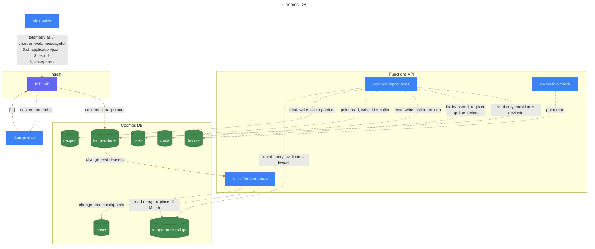

## Ingest

View `ingest` on the site: https://stevebargelt.github.io/meatgeekv2/#/view/ingest/

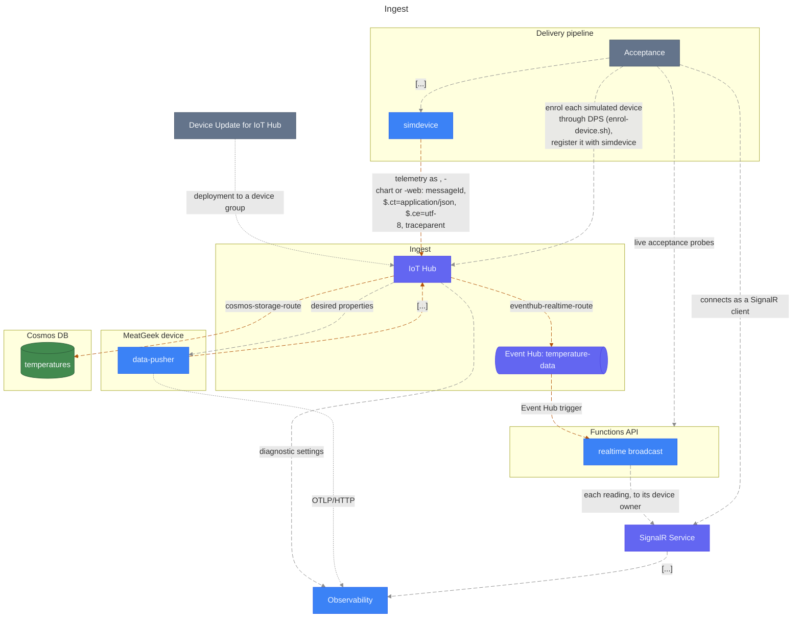

## Observability

The API exports straight to Application Insights at a 0.5 sampling ratio. The Go
services sample every span (`AlwaysSample`) and export OTLP/HTTP to the collector, which
is off by default (`enable_native_otlp = false`); with no `OTEL_EXPORTER_OTLP_ENDPOINT`
they export nothing. Four metric alerts and three activity-log alerts notify one action
group; the budgets email through their own `contact_emails`.

View `observability` on the site: https://stevebargelt.github.io/meatgeekv2/#/view/observability/

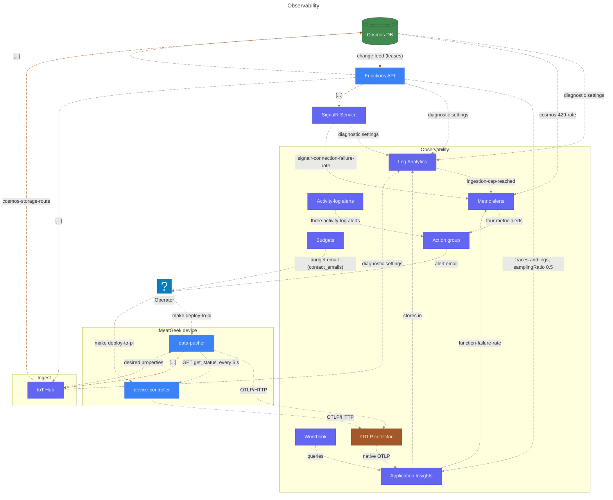

## Delivery pipeline

Pull requests feed two workflows. CI/CD Pipeline runs on every pull request and push to
main: lint and test, the Cosmos emulator tests on `windows-2025`, builds, Terraform
validation, the security scan, the `no-real-time` guard and `web-e2e`. Test repeat
(`test-repeat.yml`) runs on pull requests only: each affected non-live suite 50 times in a
row, its emulator suite on `windows-2025`; it starts nothing and is not a required check.
A green CI run on main starts the apply, then the deploy and its two acceptance jobs. When
a web-acceptance sign-in step fails, the proof writes a scrubbed `sign-in-diagnostic.txt`,
the leak check runs over it, and the run uploads the `web-acceptance-diagnostics` artifact.

View `pipeline` on the site: https://stevebargelt.github.io/meatgeekv2/#/view/pipeline/

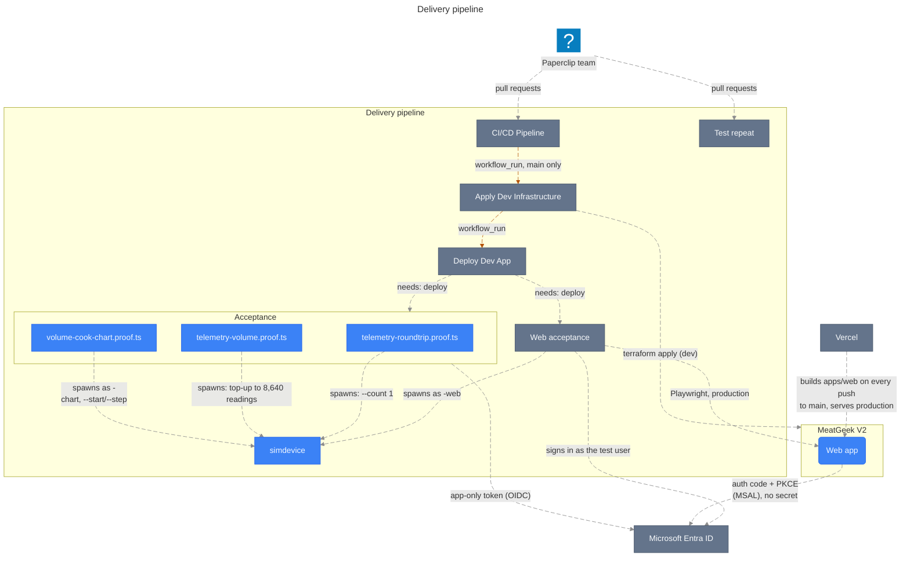

---

# Deployment

## Deployment: dev

What runs where. The web app is served by Vercel (production, built from main) and calls the dev API. The OTLP collector is not deployed (enable_native_otlp = false); the simulated device runs only on the CI runner, in the dev acceptance jobs.

View `devDeployment` on the site: https://stevebargelt.github.io/meatgeekv2/#/view/devDeployment/

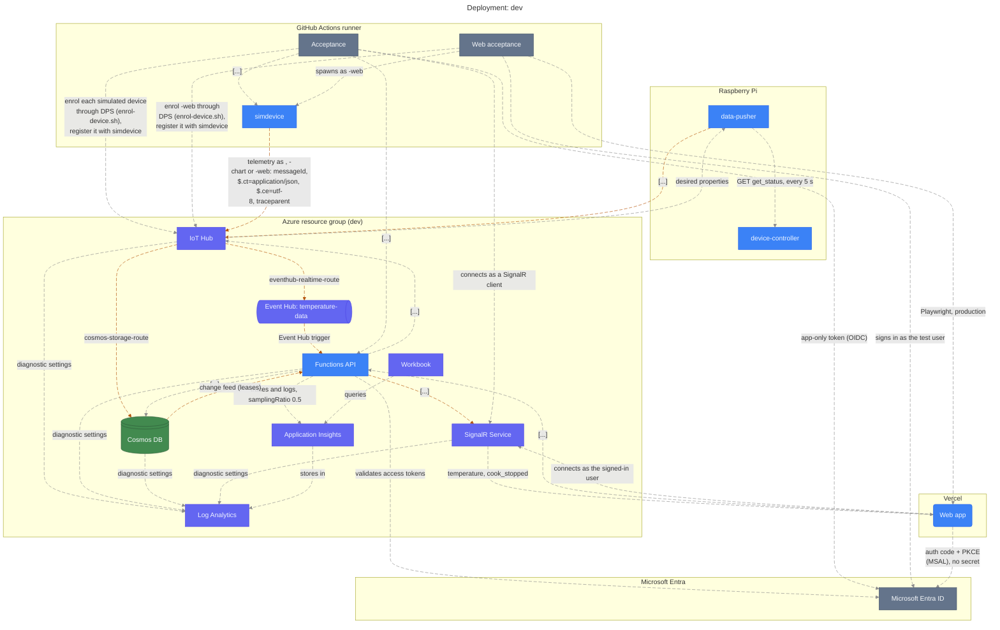

---

# Flows, today

## Flow: one temperature reading

Today. Both paths are live. Storage: IoT Hub's `cosmos-storage-route` writes Cosmos.
Push: Event Hub, then `broadcastTemperature`, then SignalR, addressed to the device owner,
then the web app's live panel (see `watchCook`). The acceptance proofs are SignalR clients
too (`signalr negotiate`, `signalr live temperature`, `signalr isolation`). Measured
send-to-browser delay: `METRIC web-push-ms` 510 (run 44837747351); the proofs' earlier
`signalr-delivery-ms` 18424 (run 44673261258) was a cold start. Single dev samples.
Two correlation axes ride on each reading. `correlation.id` is cook-scoped: the device
twin's desired `correlationId` (see `cookStart`), persisted in `cooksession` and stamped
on every message for the whole cook. `traceparent` is per message, from the
`publisher.publish` span; no Function reads it back.

View `telemetry` on the site: https://stevebargelt.github.io/meatgeekv2/#/view/telemetry/

```mermaid
---
title: "Flow: one temperature reading"
---
graph LR
  Smoker@{ shape: rectangle, label: "Pellet smoker" }
  MeatgeekEdgePusherSession@{ shape: rectangle, label: "cooksession" }
  MeatgeekEdgePusherCollector@{ shape: rectangle, label: "collector" }
  MeatgeekEdgeController@{ shape: rectangle, label: "device-controller" }
  MeatgeekEdgePusherQueue@{ shape: rectangle, label: "disk queue" }
  MeatgeekEdgePusherTracing@{ shape: rectangle, label: "telemetry" }
  MeatgeekEdgePusherIot@{ shape: rectangle, label: "iothub client" }
  MeatgeekCloudIngestIothub@{ shape: rectangle, label: "IoT Hub" }
  MeatgeekCloudDataTemperatures@{ shape: cylinder, label: "temperatures" }
  MeatgeekCloudIngestEventhub@{ shape: horizontal-cylinder, label: "Event Hub: temperature-data" }
  MeatgeekCloudApiBroadcast@{ shape: rectangle, label: "realtime broadcast" }
  MeatgeekCloudRealtime@{ shape: rectangle, label: "SignalR Service" }
  MeatgeekWebLivePanel@{ shape: rectangle, label: "live panel" }
  MeatgeekCloudApiTemperatures@{ shape: rectangle, label: "temperatures" }
  MeatgeekCloudApiRepos@{ shape: rectangle, label: "cosmos repositories" }
  Smoker -. "`grill and probe temperatures`" .-> MeatgeekEdgeController
  MeatgeekEdgePusherCollector -. "`GET get_status`" .-> MeatgeekEdgeController
  MeatgeekEdgePusherSession -. "`active cook id, correlation id`" .-> MeatgeekEdgePusherCollector
  MeatgeekEdgePusherCollector -. "`enqueue`" .-> MeatgeekEdgePusherQueue
  MeatgeekEdgePusherQueue -. "`drain`" .-> MeatgeekEdgePusherIot
  MeatgeekEdgePusherTracing -. "`publisher.publish span, traceparent`" .-> MeatgeekEdgePusherIot
  MeatgeekEdgePusherIot -. "`publish (MQTT 8883, QoS 1)`" .-> MeatgeekCloudIngestIothub
  MeatgeekCloudIngestIothub -. "`cosmos-storage-route`" .-> MeatgeekCloudDataTemperatures
  MeatgeekCloudIngestIothub -. "`eventhub-realtime-route`" .-> MeatgeekCloudIngestEventhub
  MeatgeekCloudIngestEventhub -. "`Event Hub trigger, consumer group
api-broadcast`" .-> MeatgeekCloudApiBroadcast
  MeatgeekCloudApiBroadcast -. "`each reading to its owner`" .-> MeatgeekCloudRealtime
  MeatgeekCloudRealtime -. "`temperature`" .-> MeatgeekWebLivePanel
  MeatgeekCloudApiTemperatures -. "`history or current reading`" .-> MeatgeekCloudApiRepos
  MeatgeekCloudApiRepos -. "`query by deviceId`" .-> MeatgeekCloudDataTemperatures
  classDef muted fill:#64748b,stroke:#475569,color:#f8fafc
  class Smoker muted
  classDef primary fill:#3b82f6,stroke:#2563eb,color:#eff6ff
  class MeatgeekEdgePusherSession,MeatgeekEdgePusherCollector,MeatgeekEdgeController,MeatgeekEdgePusherQueue,MeatgeekEdgePusherTracing,MeatgeekEdgePusherIot,MeatgeekCloudApiBroadcast,MeatgeekWebLivePanel,MeatgeekCloudApiTemperatures,MeatgeekCloudApiRepos primary
  classDef indigo fill:#6366f1,stroke:#4f46e5,color:#eef2ff
  class MeatgeekCloudIngestIothub,MeatgeekCloudIngestEventhub,MeatgeekCloudRealtime indigo
  classDef green fill:#428a4f,stroke:#2d5d39,color:#f8fafc
  class MeatgeekCloudDataTemperatures green
  linkStyle 0,1,2,3,4,5,10,11,12,13 stroke:#8D8D8D,stroke-dasharray:8 4
  linkStyle 6,7,8,9 stroke:#b45309,stroke-dasharray:8 4
```

Steps:

- **1.** Pellet smoker → device-controller: grill and probe temperatures
- **2.** collector → device-controller: GET get_status. Local HTTP poll of `/api/robots/MeatGeekBot/commands/get_status`, every 5 s.
- **3.** cooksession → collector: active cook id, correlation id. The cook id and correlation id come from one `cooksession` snapshot, the values the twin client last applied from the device twin's desired properties (see `cookStart`).
- **4.** collector → disk queue: enqueue
- **5.** disk queue → iothub client: drain
- **6.** telemetry → iothub client: publisher.publish span, traceparent. Every message gets its own span and `traceparent` (W3C Trace Context), sampled always.
- **7.** iothub client → IoT Hub: publish (MQTT 8883, QoS 1). Message properties: `messageId`, `$.ct=application/json`, `$.ce=utf-8`, `correlation.id` (cook-scoped) and `traceparent` (per message). Device SAS, renewed five minutes before it expires.
- **8a.** IoT Hub → temperatures (`meatgeek.cloud.data.temperatures`): cosmos-storage-route. **Live.** IoT Hub writes the document itself, by managed identity, partition value from `{deviceid}`. No Function runs, so nothing reads `traceparent` back.
- **8b.** IoT Hub → Event Hub: temperature-data: eventhub-realtime-route. **Live.** Every message is copied to the `temperature-data` Event Hub.
- **9.** Event Hub: temperature-data → realtime broadcast: Event Hub trigger, consumer group api-broadcast. **Live.** `broadcastTemperature` (HAR-60), `cardinality: many`, identity-based. The device is the hub-stamped `iothub-connection-device-id`; the reading is mapped by `toTemperatureReading`, as `GET /temperatures/current` does, plus `enqueuedTimeUtc`.
- **10.** realtime broadcast → SignalR Service: each reading to its owner. **Live.** SignalR output binding, target `temperature`, hub `temperatureHub`, `userId` = the device owner, read once per device per batch (HAR-81).
- **11.** SignalR Service → live panel: temperature. **Live.** To the browser of the owner, when a cook detail page is open. `METRIC web-push-ms` 510 (run 44837747351). (Opens `watchCook`.)
- **12.** temperatures (`meatgeek.cloud.api.temperatures`) → cosmos repositories: history or current reading (Opens `readHistory`.)
- **13.** cosmos repositories → temperatures (`meatgeek.cloud.data.temperatures`): query by deviceId

## Flow: watch a cook

The web app's cook detail page, live in production on Vercel. It loads the cook and its
chart from the server-side rollups, then opens one SignalR connection and appends every
pushed reading to the live panel and the chart. Proven live by Deploy Dev App's
`web-acceptance` job, signed in as the acceptance test user: `METRIC web-push-ms` 510
(run 44837747351).

View `watchCook` on the site: https://stevebargelt.github.io/meatgeekv2/#/view/watchCook/

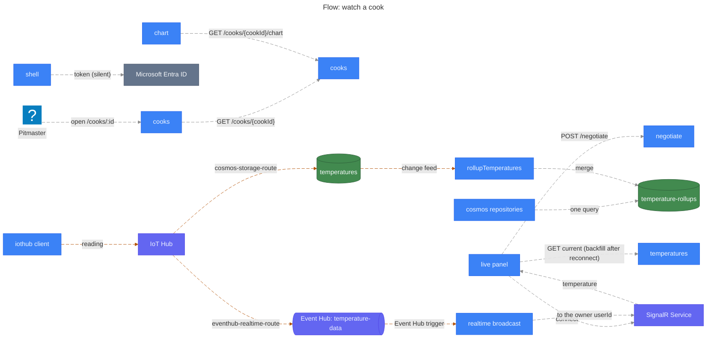

Steps:

- **1.** Pitmaster → cooks (`meatgeek.web.cooks`): open /cooks/:id
- **2.** shell → Microsoft Entra ID: token (silent). `acquireTokenSilent` for `access_as_user` (cache, then refresh token); every API call carries it as a bearer token.
- **3.** cooks (`meatgeek.web.cooks`) → cooks (`meatgeek.cloud.api.cooks`): GET /cooks/{cookId}
- **4.** chart → cooks (`meatgeek.cloud.api.cooks`): GET /cooks/{cookId}/chart. Read from the rollups, never the raw readings: at most 720 points, one avg line per channel with a min/max band. A 12 h cook costs 6.19 RU (`METRIC chart-ru-12h`, budget 40).
- **5.** cosmos repositories → temperature-rollups: one query. Single-partition (partition = deviceId) over the hours the cook covers, about 13 documents for 12 h.
- **6.** live panel → negotiate: POST /negotiate
- **7.** live panel → SignalR Service: connect
- **8.** iothub client → IoT Hub: reading
- **9.** IoT Hub → Event Hub: temperature-data: eventhub-realtime-route
- **10.** Event Hub: temperature-data → realtime broadcast: Event Hub trigger
- **11.** realtime broadcast → SignalR Service: to the owner userId
- **12.** SignalR Service → live panel: temperature. `METRIC web-push-ms` 510 (run 44837747351), from the reading timestamp to the browser showing it. The panel goes `stale` after 3 x the device `pollingInterval` with no reading.
- **13.** live panel → temperatures (`meatgeek.cloud.api.temperatures`): GET current (backfill after reconnect). After every connect and reconnect, so a reading missed while disconnected is shown.
- **14.** IoT Hub → temperatures (`meatgeek.cloud.data.temperatures`): cosmos-storage-route
- **15.** temperatures (`meatgeek.cloud.data.temperatures`) → rollupTemperatures: change feed
- **16.** rollupTemperatures → temperature-rollups: merge. One etag read-merge-replace per device-hour document; at-least-once. The next chart load includes the reading.

## Flow: start a cook

POST /cooks as the code does it now. The active cook is device state: the API syncs the
device twin's desired properties to Cosmos, and the Pi applies them and reports them back
(HAR-58, HAR-66). The twin persists, so a Pi that is offline when the cook starts gets it
when it next connects. `cook_started` goes to the owning user's SignalR connections, not
to the Pi (MG-30). Sign-in (Easy Auth, then the principal) and the ownership check run
first, as in the `api` view. Stopping a cook follows the same path: the twin's desired
cook is cleared and `cook_stopped` goes to the owner, whose web live panel consumes it.

View `cookStart` on the site: https://stevebargelt.github.io/meatgeekv2/#/view/cookStart/

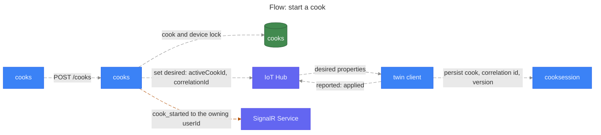

Steps:

- **1.** cooks (`meatgeek.web.cooks`) → cooks (`meatgeek.cloud.api.cooks`): POST /cooks. Through Easy Auth and the principal (`userId = tid:oid`; a missing header is 401). The web app's start form sends a client-generated id, one per intent, so a retried submit starts the cook once. The ownership check is one point read on `devices`: a foreign or unregistered device gets 403 `DEVICE_NOT_OWNED`, with no write and no event. The live callers are the web app and the acceptance proofs.
- **2.** cooks (`meatgeek.cloud.api.cooks`) → cooks (`meatgeek.cloud.data.cooks`): cook and device lock. One transactional batch in the caller partition: the cook and its device lock commit together, so a device holds at most one active cook (MG-84).
- **3.** cooks (`meatgeek.cloud.api.cooks`) → IoT Hub: set desired: activeCookId, correlationId. After the write, synced to the device lock under the twin etag (`If-Match`): GET the twin, read the active cook from Cosmos, PATCH only if they differ, then re-read. Managed identity with `IoT Hub Twin Contributor`. A failed sync answers 503 `DEVICE_TWIN_UPDATE_FAILED`; the cook stays written and a retry of the same request heals the twin.
- **4.** IoT Hub → twin client: desired properties. Delivered on connect (a full GET) or on change (a patch), so an offline Pi catches up. Patches apply in `$version` order.
- **5.** twin client → cooksession: persist cook, correlation id, version. Written to `/var/lib/meatgeek-pusher/cooksession.json`. From then every reading carries this cook id and correlation id. (Opens `telemetry`.)
- **6.** twin client → IoT Hub: reported: applied. `activeCookId`, `correlationId` and `appliedDesiredVersion`: the acknowledgement. Proven live by the `device twin` acceptance proof, with the device offline when the cook starts.
- **7.** cooks (`meatgeek.cloud.api.cooks`) → SignalR Service: cook_started to the owning userId. Sent only after the write succeeds, on hub `temperatureHub`, to the caller's `userId` ("<tid>:<oid>"), never to the deviceId (MG-30). The envelope carries `correlation: CorrelationContext { id }`, the same id the twin carries. The `signalr isolation` proof receives it as the owner. The web live panel listens for `temperature` and `cook_stopped`: when the cook is stopped, `cook_stopped` reaches it the same way and the page shows the cook as ended.

## Flow: read temperature history

GET /temperatures/history for a device. Its live caller is the acceptance suite; the web app reads a cook through its chart (see `watchCook`), not raw history.

View `readHistory` on the site: https://stevebargelt.github.io/meatgeekv2/#/view/readHistory/

```mermaid
---
title: "Flow: read temperature history"
---
graph LR
  DeliveryAcceptance@{ shape: rectangle, label: "Acceptance" }
  MeatgeekCloudApiEasyauth@{ shape: rectangle, label: "Easy Auth" }
  MeatgeekCloudApiPrincipal@{ shape: rectangle, label: "principal" }
  MeatgeekCloudApiTemperatures@{ shape: rectangle, label: "temperatures" }
  MeatgeekCloudApiOwnership@{ shape: rectangle, label: "ownership check" }
  MeatgeekCloudDataDevices@{ shape: cylinder, label: "devices" }
  MeatgeekCloudApiRepos@{ shape: rectangle, label: "cosmos repositories" }
  MeatgeekCloudDataTemperatures@{ shape: cylinder, label: "temperatures" }
  DeliveryAcceptance -. "`GET /temperatures/history`" .-> MeatgeekCloudApiEasyauth
  MeatgeekCloudApiEasyauth -. "`X-MS-CLIENT-PRINCIPAL`" .-> MeatgeekCloudApiPrincipal
  MeatgeekCloudApiPrincipal -. "`userId`" .-> MeatgeekCloudApiTemperatures
  MeatgeekCloudApiTemperatures -. "`does the caller own this device?`" .-> MeatgeekCloudApiOwnership
  MeatgeekCloudApiOwnership -. "`point read`" .-> MeatgeekCloudDataDevices
  MeatgeekCloudApiTemperatures -. "`one page of readings`" .-> MeatgeekCloudApiRepos
  MeatgeekCloudApiRepos -. "`one page by continuation token;
partition = deviceId`" .-> MeatgeekCloudDataTemperatures
  classDef slate fill:#64748b,stroke:#475569,color:#f8fafc
  class DeliveryAcceptance slate
  classDef primary fill:#3b82f6,stroke:#2563eb,color:#eff6ff
  class MeatgeekCloudApiEasyauth,MeatgeekCloudApiPrincipal,MeatgeekCloudApiTemperatures,MeatgeekCloudApiOwnership,MeatgeekCloudApiRepos primary
  classDef green fill:#428a4f,stroke:#2d5d39,color:#f8fafc
  class MeatgeekCloudDataDevices,MeatgeekCloudDataTemperatures green
  linkStyle 0,1,2,3,4,5,6 stroke:#8D8D8D,stroke-dasharray:8 4
```

Steps:

- **1.** Acceptance → Easy Auth: GET /temperatures/history
- **2.** Easy Auth → principal: X-MS-CLIENT-PRINCIPAL
- **3.** principal → temperatures (`meatgeek.cloud.api.temperatures`): userId
- **4.** temperatures (`meatgeek.cloud.api.temperatures`) → ownership check: does the caller own this device?
- **5.** ownership check → devices: point read. `getDeviceOwnership`. Not owned or not found: 404 `DEVICE_NOT_FOUND`, about 1 RU.
- **6.** temperatures (`meatgeek.cloud.api.temperatures`) → cosmos repositories: one page of readings
- **7.** cosmos repositories → temperatures (`meatgeek.cloud.data.temperatures`): one page by continuation token; partition = deviceId. `maxItemCount` = limit (at most 1000) and the continuation token from the previous page. No COUNT and no OFFSET since HAR-75, so a deep page costs what the first does: the volume proof fails unless the last page costs at most 1.5 x the first (measured 47.77 RU first, 36.09 RU last). Measured: see `telemetryProof`. (Opens `telemetryProof`.)

## Flow: a merge reaches dev

What happens after the Reviewer merges a pull request. Vercel builds the web app from the same push, in parallel with the Azure path.

View `mergeToDeploy` on the site: https://stevebargelt.github.io/meatgeekv2/#/view/mergeToDeploy/

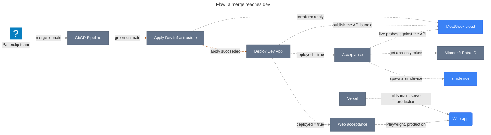

Steps:

- **1a.** Paperclip team → CI/CD Pipeline: merge to main. The push to `main` starts CI/CD Pipeline.
- **1b.** Vercel → Web app: builds main, serves production. The Vercel Git integration, on its own: no workflow and no Vercel token in GitHub. It reports back only through the `Vercel` commit status.
- **2.** CI/CD Pipeline → Apply Dev Infrastructure: green on main. `workflow_run`, so the workflow file that runs is always the one on `main`. If a newer commit has landed, this run ends green **without applying**.
- **3.** Apply Dev Infrastructure → MeatGeek cloud: terraform apply
- **4.** Apply Dev Infrastructure → Deploy Dev App: apply succeeded
- **5.** Deploy Dev App → MeatGeek cloud: publish the API bundle
- **6.** Deploy Dev App → Acceptance: deployed = true
- **7.** Acceptance → Microsoft Entra ID: get app-only token
- **8.** Acceptance → MeatGeek cloud: live probes against the API
- **9.** Acceptance → simdevice: spawns simdevice. Live telemetry round trip and volume proofs through IoT Hub. (Opens `telemetryProof`.)
- **10.** Deploy Dev App → Web acceptance: deployed = true. In parallel with `acceptance`.
- **11.** Web acceptance → Web app: Playwright, production. Waits for `/version.json` to show this commit or a descendant (`METRIC web-deploy-wait-s`), signs in on the Microsoft pages as the test user, starts a cook on `<sim>-web` and sees a pushed reading (`METRIC web-push-ms`). (Opens `watchCook`.)

## Flow: live telemetry proof (dev acceptance)

Every Deploy Dev App acceptance job proves the telemetry path end to end:
`telemetry-roundtrip.proof.ts`, then `telemetry-volume.proof.ts`. `simdevice` sends as
`meatgeek-dev-simulated-smoker` (MQTT 8883, device SAS, QoS 1, the data-pusher's own
publish code); no Function is in the write path.

Measured (single dev samples, not targets): `roundtrip-ms` 1211 (run 44603121177) and
1235 (run 44612029684); `topup-sent`/`topup-ms` 2175 / 109996 (~19.8 readings/s, run
44612029684). Before HAR-75 history paged by `OFFSET` and every request paid a `COUNT(1)`:
in run 44612029684 the 100-reading page cost 11.95 RU at offset 0 and 24.12 RU at offset
8600. Since HAR-75 it pages by continuation token with no COUNT, and the volume proof fails
unless the last page of a walk costs at most 1.5 x the first.

View `telemetryProof` on the site: https://stevebargelt.github.io/meatgeekv2/#/view/telemetryProof/

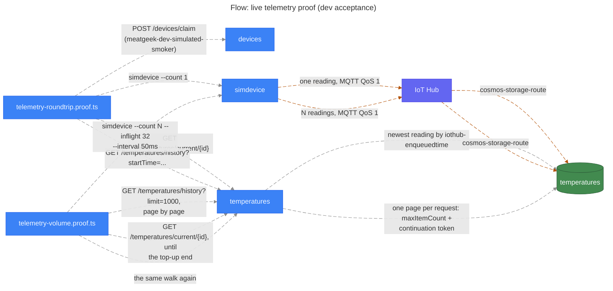

Steps:

- **1.** telemetry-roundtrip.proof.ts → devices: POST /devices/claim (meatgeek-dev-simulated-smoker). HAR-140: claimed with the claim code the device minted (`simdevice claim-code`), once per run and never released: 201 if the caller did not hold it, 200 if it did (`claimedAt` unchanged); later groups claim again with the same code and get 200.
- **2.** telemetry-roundtrip.proof.ts → simdevice: simdevice --count 1
- **3.** simdevice → IoT Hub: one reading, MQTT QoS 1. Properties `messageId`, `$.ct=application/json`, `$.ce=utf-8`, `traceparent`.
- **4.** IoT Hub → temperatures (`meatgeek.cloud.data.temperatures`): cosmos-storage-route
- **5.** telemetry-roundtrip.proof.ts → temperatures (`meatgeek.cloud.api.temperatures`): GET /temperatures/current/{id}. Polled every 1 s, 120 s cap, until it returns the sent reading. Prints `METRIC roundtrip-ms`: 1211 and 1235.
- **6.** temperatures (`meatgeek.cloud.api.temperatures`) → temperatures (`meatgeek.cloud.data.temperatures`): newest reading by iothub-enqueuedtime
- **7.** telemetry-roundtrip.proof.ts → temperatures (`meatgeek.cloud.api.temperatures`): GET /temperatures/history?startTime=.... The page holds the sent reading.
- **8.** telemetry-volume.proof.ts → temperatures (`meatgeek.cloud.api.temperatures`): GET /temperatures/history?limit=1000, page by page. Walks the simulated device by continuation token, one page at a time, to count its readings.
- **9.** telemetry-volume.proof.ts → simdevice: simdevice --count N --inflight 32 --interval 50ms. Only if the walk counts fewer than 8,640 (12 h at one every 5 s). N = 8,640 - counted + 60. Measured `topup-sent`/`topup-ms` 2175 / 109996, ~19.8 readings/s.
- **10.** simdevice → IoT Hub: N readings, MQTT QoS 1
- **11.** IoT Hub → temperatures (`meatgeek.cloud.data.temperatures`): cosmos-storage-route
- **12.** telemetry-volume.proof.ts → temperatures (`meatgeek.cloud.api.temperatures`): GET /temperatures/current/{id}, until the top-up end. After a top-up only. Polled every 10 s, 15 min cap, until the current reading is at or after the reading 32 places from the top-up last.
- **13.** telemetry-volume.proof.ts → temperatures (`meatgeek.cloud.api.temperatures`): the same walk again. Prints `history-ru-first-page`, `history-ru-last-page` and `history-pages`; fails unless the last page costs at most 1.5 x the first.
- **14.** temperatures (`meatgeek.cloud.api.temperatures`) → temperatures (`meatgeek.cloud.data.temperatures`): one page per request: maxItemCount + continuation token. No COUNT and no OFFSET (HAR-75), so a deep page costs what the first does. The job copies every `METRIC` line into the run summary.

## Device software updates

How a new build reaches the Pi. Solid: today, by hand over SSH. Grey dotted: over-the-air through Device Update for IoT Hub, not built.

View `deviceUpdates` on the site: https://stevebargelt.github.io/meatgeekv2/#/view/deviceUpdates/

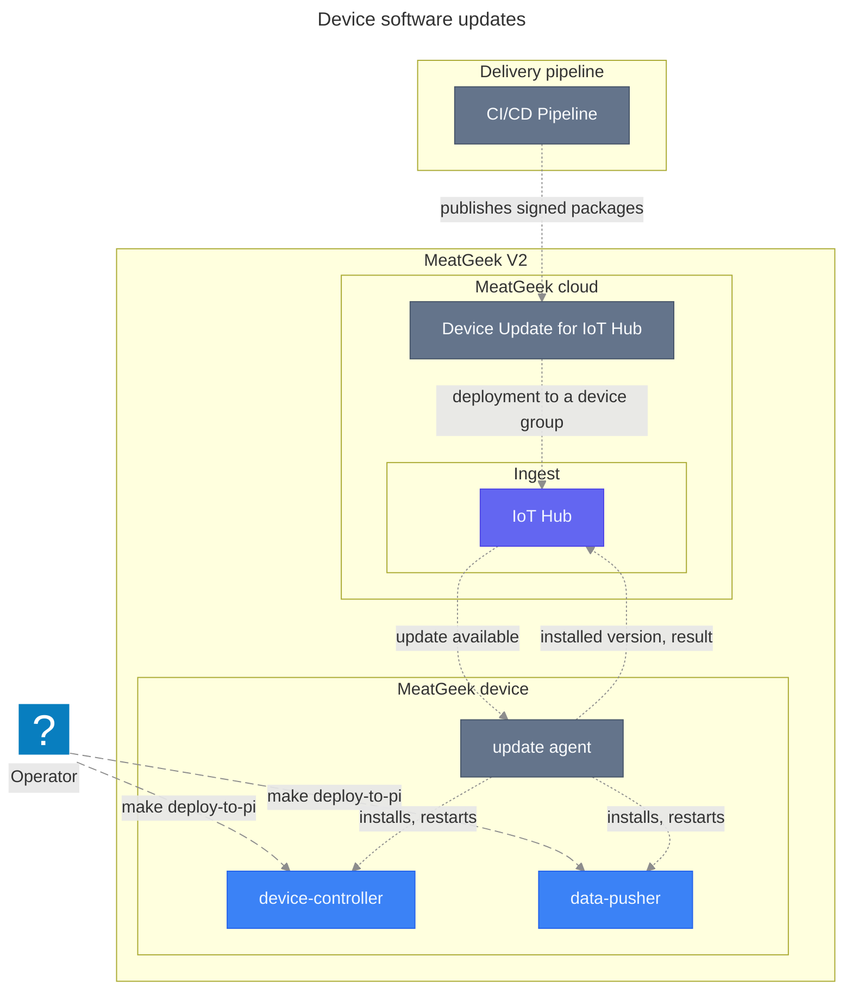
